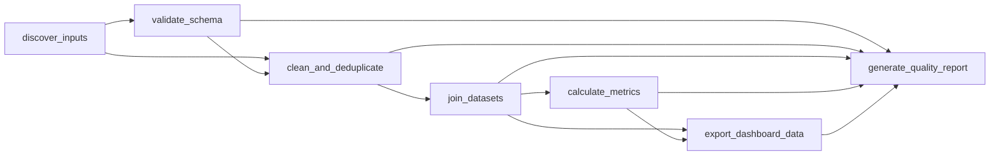

# Pipeline Architecture

## Design principle: thin DAG, fat transforms

`dags/insightforge_etl_dag.py` contains no pandas imports and no file I/O
at module (DAG-parse) scope - every `@task` body is a small adapter that
pulls plain values from Airflow's context and calls a pure `*_impl`
function in `transforms/`. `cli/run_pipeline.py` calls the exact same
functions in the exact same order, so there is only one implementation of
the actual logic - Airflow is an orchestration layer on top of it, not a
second copy of it.

## DAG graph

This is generated directly from the live DAG object's
`task_dict`/`downstream_task_ids` (see `scripts/render_dag_diagram.py` and
`docs/media/dag_graph.svg`/`dag_graph.dot`) - not hand-drawn. The machine
this was built on has no graphviz/`dot` binary and no passwordless sudo, so
`airflow dags show --save dag.png` (the Airflow-UI-identical render)
couldn't run here; `render_dag_diagram.py` is the documented fallback that
still derives the picture from the real DAG structure. See
`docs/media/dag_test_run.log` for a full successful `airflow dags test` run
captured from this exact DAG.

`generate_quality_report` deliberately fans in from five upstream tasks
(`validate_schema`, `clean_and_deduplicate`, `join_datasets`,
`calculate_metrics`, `export_dashboard_data`) because it summarizes the
whole run, not just the immediately-preceding step.

## Idempotency

- **Deterministic output path**: `output/{logical_date}/`, computed once by
  `discover_inputs` from Airflow's `logical_date` and threaded through
  every downstream task's return value (`outputDir`).
- **Overwrite-in-place, never append**: every write goes through
  `io_utils.atomic_write_text/json` (write to a `.tmp` file, then
  `os.replace`) or pandas' `to_csv` writing the full file fresh each time -
  a rerun for the same logical date always fully replaces the same
  filenames, never accumulates duplicate or partial data.
- **No runtime randomness**: `sample_data/*.csv` are static, committed
  files generated once by a seeded script (`scripts/generate_sample_data.py`,
  `random.Random(20260101)`) - the DAG itself never generates or samples
  random data while running.
- **Pure functions**: every `*_impl` function takes explicit inputs and
  returns explicit outputs with no hidden global state, verified by
  `tests/test_full_pipeline_e2e.py::test_rerunning_for_the_same_logical_date_is_byte_for_byte_idempotent`,
  which runs the pipeline twice and diffs every output file.
- **Dedup runs against raw input each time**, not against a previous run's
  cleaned output, so reruns never compound (re-deduplicating an
  already-deduplicated file, silently dropping legitimate repeats).

## XCom discipline

Every task passes only file paths, counts, and a handful of headline
numbers between tasks - never a DataFrame. `tests/test_xcom_size_guard.py`
runs the real pipeline and asserts every task's XCom payload is under 10KB
and `json.dumps`-safe, as a regression guard against this creeping back in.

## Retries and failure messages

`default_args` gives every task 2 retries with exponential backoff.
`transforms/logging_utils.py` defines task-specific exceptions
(`InputDiscoveryError`, `SchemaValidationError`, `JoinIntegrityError`) that
name the offending file/column/count directly in the message, so a failed
task's Airflow log (or `airflow dags test` output) is diagnostic on its
own - see `docs/TROUBLESHOOTING.md`.

## Compatibility with the browser dashboard

- `transforms/metrics.py`'s KPI formulas mirror `src/lib/metrics/kpis.ts`
  (revenue sum, AOV, profit margin, repeat-customer rate, etc.) and its
  segmentation thresholds mirror `src/lib/metrics/segmentation.ts` exactly
  (loyal-order-count 4, high-value revenue 500, at-risk 90 days, inactive
  180 days).
- `transforms/export.py`'s CSV headers ("Date", "Order ID", "Revenue", ...)
  match the exact keyword vocabulary `src/lib/csv/mapping.ts`'s
  `autoDetectMapping()` scores against, so the export auto-maps in the
  Import Wizard with zero manual column mapping - verified by hand: 14 of
  16 exported columns auto-detected correctly (Latitude/Longitude/Review
  text/Marketing source/Campaign/Status are simply not present in the
  export, since the pipeline's sample data doesn't populate them either).
- Loading the pipeline's own `05_dashboard_export.csv` into the running
  browser app reproduced the exact same headline numbers the pipeline
  itself computed (Revenue $289,656.41, Orders 1,500) - see
  `docs/media/dashboard_with_pipeline_output.png`.

## Data dictionary

See [`DATA_DICTIONARY.md`](DATA_DICTIONARY.md) for every field, stage by
stage, mapped to its TypeScript counterpart where one exists.
